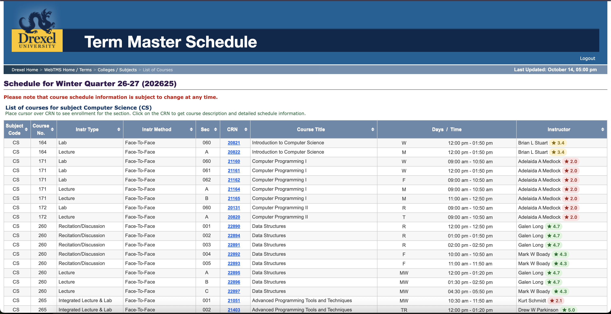
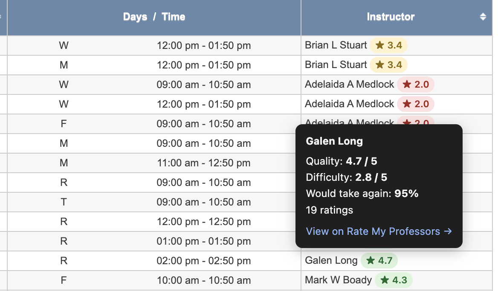

  

<h1 align="center">DU ProfessorView</h1>

  Rate My Professors ratings, right next to instructor names on Drexel's
  Term Master Schedule and Banner class registration.

  
  

  <a href="https://chromewebstore.google.com/detail/du-professorview/hglcajcloiiocoonpbfcdmgljofenlcp"><b>Add to Chrome</b></a>
  ·
  <a href="https://mlhv.github.io/drexel-rmp/privacy.html">Privacy policy</a>

## Features

- A color-coded ★ badge next to each instructor
- Hover for difficulty, would-take-again %, and number of ratings
- One click to the professor's full Rate My Professors page
- Multi-instructor sections get one badge per instructor
- If no confident match exists, you see "n/a", never the wrong professor's rating

  

## Install

1. Open the [Chrome Web Store listing](https://chromewebstore.google.com/detail/du-professorview/hglcajcloiiocoonpbfcdmgljofenlcp) and click **Add to Chrome**.
2. Log in to Drexel and open the [Term Master Schedule](https://termmasterschedule.drexel.edu/webtms_du/) or Banner's Browse Classes / registration pages.
3. Badges appear next to instructor names automatically. There's nothing to configure.

## Privacy

The extension only reads instructor names on Drexel course pages to look up their
public ratings. No login data, no schedule, no browsing history, no analytics.
Full policy: https://mlhv.github.io/drexel-rmp/privacy.html

## How it works

Each instructor name is looked up in order: the extension's local cache (fresh for
24 hours) → a Cloudflare Worker with a shared KV cache (3 s timeout) → Rate My
Professors directly → a stale local entry if everything else fails. Names are matched
against Drexel's RMP listings with a scoring function, and low-confidence matches
show "n/a".

## Development

### Layout

- `packages/extension`: WXT MV3 extension (content scripts, background lookup)
- `packages/worker`: Cloudflare Worker cache (`GET /prof?name=…`), live at
  https://drexel-rmp-worker.mlhv.workers.dev
- `packages/shared`: types, RMP GraphQL client, name-match scoring

### Commands

    pnpm install
    pnpm test                          # all unit tests
    pnpm -F @drexel-rmp/extension dev  # launches Chrome with the extension loaded
    pnpm -F @drexel-rmp/worker dev     # worker on http://localhost:8787

To point a dev build at the local Worker, create `packages/extension/.env.development.local`
containing `WXT_WORKER_URL=http://localhost:8787`.

To load a local build instead of the store version: `pnpm -F @drexel-rmp/extension build`,
then chrome://extensions → Developer mode → Load unpacked →
`packages/extension/.output/chrome-mv3`.

### Release checks

See `docs/testing-checklist.md`. Worker deploy: `packages/worker/README.md`.
Learning notes for each build step: `docs/learning/`.
Chrome Web Store submission: `docs/store/runbook.md` (listing copy in `docs/store/listing.md`).

## License

[MIT](LICENSE) © Minh Le

Not affiliated with or endorsed by Drexel University or Rate My Professors.
